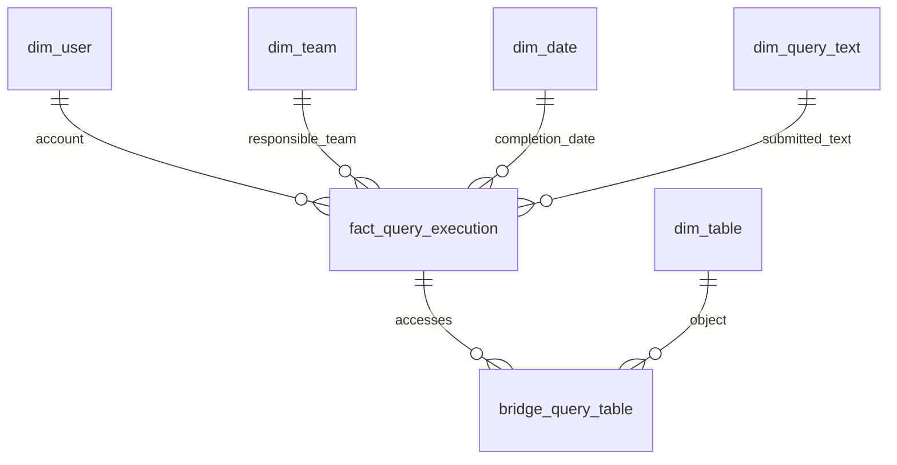

# Meta DWH: design and assumptions

For a short introduction, see the [quick overview](QUICK_OVERVIEW.md). Running instructions are in the [README](../README.md).

## Scope

This implementation answers the selection task using a local, persistent DuckDB warehouse and synthetic source exports. It does not require access to JetBrains infrastructure. Production inputs are described as Trino events stored in Iceberg tables on S3; local JSONL files stand in for an export of those events. They are not themselves Iceberg tables. CSV files simulate an external identity/team registry. SQL creates and queries the warehouse; Python performs the transformations and executes parameterized SQL writes.

The model is a star with a bridge for multiple table references. There is one measurement fact per execution. No separate catalog/schema dimensions, orchestration service, additional source database or precomputed aggregate layer is required for this demonstration.

## Key assumptions

The task describes Trino events stored in Iceberg tables on S3, but does not provide the actual datasets or their schema. I have no access to the production system. The following are assumptions made for this implementation, not claims about JetBrains infrastructure. I chose them to make the local demonstration manageable and keep the focus on warehouse modeling and transformations.

- **A historical user/team registry is available.** I assume an external source provides stable user/team IDs, descriptive attributes, and membership intervals (`valid_from`, `valid_to`). I do not know whether such a registry exists or whether it retains history rather than only current membership. Assuming history lets ETL assign each query to the team responsible at its creation time without building a separate system to collect that history.
- **The registry is complete and correct.** Every observed account and query creation time maps to exactly one responsible team, including service accounts. This deliberately simplifies enrichment and avoids adding missing-mapping and registry-conflict handling to this exercise.
- **Sources expose reliable change timestamps.** Raw event exports provide `raw_ingested_at`, and registry records provide `updated_at` on insertion and every modification. These are assumed source/export fields; the task does not guarantee their existence. Together with complete publication below each package cutoff, they allow a simple timestamp-based incremental load. Query lifecycle times such as `createTime` and `endTime` do not replace these timestamps.
- **Names and identifiers have a simplified lifecycle.** Account IDs/usernames remain stable, and table names are neither renamed nor reused for a different object during the demonstration. This keeps identity resolution straightforward. User/team labels use Type 1 updates because this solution preserves historical responsibility, while displaying current descriptive attributes.

## Design rationale

I chose this design to answer the two requested questions at the granularity available in the events, while keeping the local demonstration small and repeatable.

| Choice | Why I chose it |
|---|---|
| **Local DuckDB with Python and SQL** | It provides a persistent analytical database that can be run locally without access to the production infrastructure. Python handles the nested event payloads and source files; SQL defines the warehouse and reporting queries. |
| **Star schema with flat dimensions** | The main reporting filters are account, team, table and period. Keeping descriptive attributes together makes these reports straightforward and avoids extra joins through separate catalog/schema or calendar hierarchies. |
| **One fact per completed execution** | Query-level statistics naturally belong to an execution. This grain preserves its reported consumption once and includes failed executions, which also consume resources. Created events do not provide final consumption and therefore do not create additional facts. |
| **A query–table bridge with access roles** | One execution can use multiple tables and can read and write the same table. The bridge represents these relationships while keeping query-level measures in one fact row. INPUT and WRITE_TARGET distinguish the two roles. |
| **Team key stored directly on the fact; Type 1 descriptive labels** | Resolving the responsible team at query creation time preserves historical attribution and gives reports a simple team join. The source registry supplies membership history. Updating names in place keeps current labels without introducing dimension versions that the requested analysis does not require. |
| **Selected resource measures and retained execution detail** | CPU describes compute work; byte counters describe input, writer and spill volume; peak memory describes individual-query demand; wall/queue times describe latency. Separate measures retain their different meanings and aggregation rules. Query detail supports exact distinct-account counts for arbitrary periods. Large plans and task/operator payloads stay in the source because the two requested reports do not need them. |
| **A separate SQL-text dimension with an exact-text hash** | It stores a repeated SQL text once and supports grouping its executions for usage analysis. Execution identity remains the query ID; matching SQL text does not make two executions duplicates. |
| **Incremental selection by source change times, with one transactional checkpoint update** | Under the stated timestamp assumptions, this gives a simple way to select new events and registry changes. Ingestion time also captures late events about older queries. Deduplication makes reprocessing safe, and committing data with checkpoints prevents a failed batch from advancing past unapplied changes. |

## Tables, grain and relationships

| Table | Grain / identity | Main contents |
|---|---|---|
| `fact_query_execution` | One accepted completed execution; unique `(cluster_id, query_id)` | User/team/date/text keys, lifecycle times, resource measures, state, diagnostics and provenance |
| `dim_user` | One stable account; `user_id` from registry | Trino username, display name, HUMAN/SERVICE/SHARED classification, active status |
| `dim_team` | One stable team; `team_id` from registry | Current team name and active status |
| `dim_table` | One observed `(catalog_name, schema_name, table_name)` | Table identity; names are stable under the assumptions below |
| `dim_query_text` | One distinct exact submitted SQL text | SHA-256 of original UTF-8 text and the original text |
| `dim_date` | One observed UTC completion date | Calendar date, year, month, Monday week start and ISO weekday 1–7 |
| `bridge_query_table` | One `(query_key, table_key, access_role)` | INPUT or WRITE_TARGET and input read evidence |

Warehouse surrogate keys are independent of source IDs. A query can have many bridge rows; a table can appear in many executions. One table can be both an input and a write target of the same query. Repeated inputs, including self-joins, produce one bridge row per table/role. The calendar is filled on demand, not over an arbitrary fixed date range.

`etl_checkpoint` has one row per source (`query_events`, `registry`). `etl_load` records successful batches and their counts. `etl_issue` records rejected/conflicting records and invalid metrics, retaining the offending raw JSON and reason. These are operational tables, not additional business facts.

Primary/unique/check constraints enforce identities and valid accepted values. Most relationships also have physical foreign keys. Bridge-to-fact is a **logical foreign key**, checked by the loader and tests: DuckDB 1.4.3's indexed-update/FK limitation otherwise prevents changing a fact's team assignment while bridge rows reference it. Parent fact and bridge inserts share a transaction; there is no standalone bridge writer. See [DuckDB constraint limitations](https://duckdb.org/docs/current/sql/constraints).

## Source contract and additional metadata

Each `events.jsonl` line has our synthetic envelope: `raw_record_id`, `cluster_id`, `raw_ingested_at`, `event_type`, and `event`. The event contains a documented subset of Trino metadata/context/statistics/I/O fields. This is not a claim that the fixture contains every field emitted by a particular deployed listener. Durations have explicit units, timestamps have timezones, and byte/row counters are integers. Unavailable/excluded metrics can be null. The envelope and its ingestion timestamp are assumed valid. Syntactically unreadable JSON is retained as a rejected line.

`QueryCreated` stays in the source and is ignored for fact population. `QueryCompleted` includes FINISHED and FAILED. Cancellation can also be represented as FAILED. Unsupported event types or unusable identities/lifecycle data are rejected. Final events are treated as immutable source observations.

`createTime` is creation inside Trino after submission, not opening an editor. The optional `executionStartTime` is not interpreted as the first physical read; upstream timing can start at planning. The loader keeps it when it lies within the query lifecycle, otherwise stores NULL. `endTime` is the query's terminal lifecycle time, not a guarantee that every asynchronous cleanup action has finished. Reported durations are parsed from source values rather than reconstructed by adding phases.

The external registry comprises three CSV exports:

| File | Fields |
|---|---|
| `users_history.csv` | `user_id`, `trino_username`, `display_name`, `account_type`, `is_active`, `valid_from`, `valid_to`, `updated_at` |
| `teams_history.csv` | `team_id`, `team_name`, `is_active`, `valid_from`, `valid_to`, `updated_at` |
| `user_team_membership.csv` | `user_id`, `team_id`, `valid_from`, `valid_to`, `updated_at` |

Business intervals are `[valid_from, valid_to)`, with an empty end meaning open-ended. **The registry is assumed correct, complete and authoritative:** every observed account/query creation time resolves to exactly one user and responsible team, including service/shared accounts. There is no Unknown-team fallback or registry-conflict reconciliation. A source-contract violation aborts the transaction rather than silently assigning consumption. Stable account IDs and usernames are not reused or renamed during the demonstration; display names may change. Deactivated entities remain available with an active-status flag rather than disappearing from history/current exports.

`updated_at` changes on every insertion, correction and modification, including closure of an old membership interval. It is the source modification time, not the business effective date. New registry versions have strictly newer modification times; ambiguous same-version duplicates are excluded by the trusted-registry assumption. There are no unpublished future-effective profile changes in the exports.

Historical registry files remain **outside the DWH**. ETL resolves membership at query `createTime` and stores `team_key` directly in the fact. Type 1 dimension labels are obtained from the current registry profile at the package cutoff, independently of event processing. A late January event therefore cannot revert a team's current name. Ordinary team transfers leave older facts unchanged. A registry correction causes existing fact assignments to be checked again when membership data changes. For this small dataset, that check scans existing facts; it preserves resource measures and bridge rows.

## Metrics and reporting semantics

| Fact measure | Meaning / aggregation |
|---|---|
| `cpu_time_ms` | Reported query CPU; sum once per execution, including failed executions |
| `physical_input_bytes` | Reported physical input bytes; sum once per execution |
| `written_bytes` | Logical input bytes of writer operators; sum as reported writer work, not physical S3 growth |
| `written_rows` | Reported writer-operator input rows; not a universal DML affected-row count |
| `spilled_bytes` | Reported spill volume; sum, not peak disk capacity |
| `peak_user_memory_bytes` | Peak of Trino's user-memory accounting category per query; use max/percentiles, not a sum |
| `wall_time_ms`, `queued_time_ms` | Reported duration and queue time; use averages/percentiles for latency |

CPU may exceed wall time because tasks run in parallel. Metrics are Trino-reported consumption attributed to an execution, not complete host costs, remote-service costs or guaranteed accounting of all asynchronous cleanup/rollback. No monetary cost is inferred. Memory is not process RSS, and max individual query memory is not a simultaneous team memory peak. Time phases are not added together. Missing metrics remain NULL; resource aggregates describe the known reported portion. Reports 02 and 03 focus on resource and usage aggregates; report 05 exposes missingness and source conflicts separately. `statistics_complete` retains the source completeness flag without treating it as proof that every metric exists.

Reporting periods use **completion time in UTC `[from, to)`**. A whole execution's reported resources are allocated to its completion period, even if it crosses a period or team-transfer boundary. Responsibility uses its creation-time team. This is an explicit accounting convention, not exact time-sliced utilization.

`ioMetadata.inputs` supplies INPUT links; `ioMetadata.output` supplies the optional WRITE_TARGET. INPUT identifies a table reported as an input by the query plan and does not by itself prove positive physical reading. The analyzed reference list `metadata.tables` is not treated as proof of physical reads. For inputs, POSITIVE means any occurrence reports positive input bytes/rows. ZERO means no positives and each occurrence has at least one available zero counter. Otherwise the evidence is UNKNOWN. Invalid per-input counters are treated as unavailable and logged. This classification does not measure all object-store/metadata/cache I/O.

No query CPU, memory or total I/O is copied to bridge rows. We do not allocate join/aggregation CPU to individual tables. WRITE_TARGET records a target, not proof of nonzero committed changes. Autocommit is assumed for the examples; successful writes use the connector's supported commit behavior. Failed writes can still report writer work. Neither their counters nor the presence of a target establish committed data changes. DDL rename handling is outside scope.

The distinct-user question counts **distinct accounts of accepted completed executions with an INPUT link** to the selected table, including FAILED executions and zero/unknown reported reads. There is no query-state or read-evidence filter. This interprets "queried the table" as reported input usage, regardless of execution success. A failure before input metadata is produced cannot be attributed to a table by this report; the loader does not parse SQL text to guess inputs. Service accounts count as accounts, not people. Distinct daily counts must not be summed to obtain period-level distinct users.

SQL hashes group exact text, not executions. No whitespace/case/literal normalization is applied. Different query IDs with the same text are legitimate executions. Session context can change the meaning of identical SQL; a submitted EXECUTE can refer to different prepared statements. The hash is not a semantic fingerprint. Plans, prepared text and unused diagnostics are not modeled; the source remains available.

## Updates, duplicates and bad data

`init` requires a new database path. `incremental` uses the existing schema and committed source boundaries. Each package is a cumulative, immutable export with a common exclusive `available_until` in `manifest.json`. Initial load processes available records below the cutoff; incremental load processes ingestion/modification times in `[previous_cutoff, new_cutoff)`. Existing unchanged rows retain their original timestamps in snapshot 2.

The exporter guarantees complete publication below each cutoff: no later-discovered record/change may be assigned a timestamp behind an already committed boundary. Boundaries and timestamps share a UTC clock/precision. This is a documented simplification; without such a source contract, a timestamp-only cursor would need a different capture strategy. New query events can still describe arbitrarily old executions because selection uses ingestion time, not query end time. An existing package is scanned locally to filter its rows; this small-file demo does not claim efficient change discovery over a production S3 lake.

Dimensions, facts, bridges, issue records, successful-load audit and both checkpoints commit together. An exception rolls them back; checkpoints store the **source cutoff**, not batch finish time. Exact package replay makes no changes. Older snapshots are refused. Registry changes are processed even if there are no new queries.

| Case | Action |
|---|---|
| New account/team | Insert dimension row with a new surrogate key |
| Trusted newer profile version | Type 1 update; retain key and original insert time |
| Newly observed full table name | Insert `dim_table` row before bridge insert |
| Same execution, same relevant source content | Skip duplicate; preserve fact/bridge audit times |
| Same execution, differing relevant content | Log conflict; never choose by latest ingestion or largest CPU |
| Existing accepted execution receives a conflict | Keep accepted measures and set `has_source_conflict` |
| First observed batch contains conflicting copies | Insert no fact; keep identity blocked by the issue ledger until explicit resolution |
| Unreadable JSON, missing query ID, malformed lifecycle/unsupported state | Reject record; retain offending line or parsed envelope and reason |
| Invalid negative/nonfinite/unparseable/out-of-range metric | Keep valid execution data; replace only bad metric with NULL; log issue and flag fact |
| Missing optional metric | NULL; not automatically a data error |

JSON integer counters must be nonnegative signed-64-bit integers, and durations must include units. Decimal and exponent number tokens are preserved as text during event parsing (`parse_float=str`), so a value such as `1e309` cannot become infinity and abort event hashing or issue logging. Such counter values fail metric validation, become NULL and are logged without rejecting the otherwise valid execution. Non-standard JSON literals such as `NaN` and `Infinity` are rejected as unreadable JSON.

The event-content SHA-256 is separate from the SQL hash. It uses a canonical JSON projection of parsed modeled source fields, relevant session defaults and I/O counters, excluding ingestion metadata, JSON key order, input-list order and unused diagnostics. Decimal/exponent tokens are represented as strings in this projection. Repeated input occurrences remain significant. It does not equate differently formatted duration strings. The synthetic serializer is stable. Accept/reject/conflict decisions therefore do not depend on changing dimension labels or derived team assignments.

Raw exports are retained. Issues retain unreadable source lines or complete parsed offending envelopes, with decimal/exponent tokens represented as strings. The source export retains the original JSON representation. Accepted facts keep raw record ID, ingestion time and event-content hash. Issue IDs prevent duplicate issue rows. There is no automatic conflict-resolution UI; corrected source observations require an explicit resolution policy. Replay the two packages in sequence to reproduce acceptance history; initializing directly from the final conflicted snapshot is not equivalent to replaying that history.

Names identify tables only within the assumed catalog namespace. Table renames and drop/recreate under the same full name are excluded. Supporting them would require stable object identifiers and historical name mappings from catalog/audit metadata; Iceberg's table UUID is one potential identifier. A dimension row is not deleted because a table disappears from later usage events. The dimension represents observed usage, not a complete cluster inventory.

Audit columns distinguish source times from warehouse insert/update times. Mutable dimensions/facts have insert/update/batch metadata; immutable text/table/bridge rows have insert/batch metadata. Deterministic date rows do not need per-row load audit. A complete rebuild naturally creates new warehouse insert times and potentially different surrogate keys.

## Example queries and validation

Run `pipeline.py report` or execute the files in `sql/reports/` against the database:

1. `01_distinct_users.sql`: selected full table name and completion period.
2. `02_team_resources.sql`: selected team ID and period; success and failure included.
3. `03_daily_team_history.sql`: historical usage trend, with current team labels.
4. `04_repeated_sql.sql`: frequency and resource usage by exact SQL text.
5. `05_data_quality.sql`: accepted totals, unknown metrics, conflicts and rejections.

The test suite verifies fixed business totals, historical attribution after transfers and late arrivals, repeated SQL versus duplicates, multi-table/self-join grain, read evidence, numeric overflow handling and issue retention, conflicting payload retention, persistent blocking of conflicted identities, idempotence including audit times, registry corrections, and rollback after an injected interruption.

## Primary references

- [Trino event listeners](https://trino.io/docs/current/develop/event-listener.html): event collection model.
- [QueryContext](https://github.com/trinodb/trino/blob/master/core/trino-spi/src/main/java/io/trino/spi/eventlistener/QueryContext.java): user/context fields; no standard organizational team ID.
- [QueryStatistics](https://github.com/trinodb/trino/blob/master/core/trino-spi/src/main/java/io/trino/spi/eventlistener/QueryStatistics.java) and [QueryMonitor](https://github.com/trinodb/trino/blob/master/core/trino-main/src/main/java/io/trino/event/QueryMonitor.java): reported metrics and their mapping.
- [QueryStats](https://github.com/trinodb/trino/blob/master/core/trino-main/src/main/java/io/trino/execution/QueryStats.java): logical writer input aggregation.
- [QueryInputMetadata](https://github.com/trinodb/trino/blob/master/core/trino-spi/src/main/java/io/trino/spi/eventlistener/QueryInputMetadata.java): per-input identity and optional physical counters.
- [Iceberg identifier fields](https://iceberg.apache.org/spec/#identifier-field-ids): row uniqueness is not automatically enforced.
- [Iceberg table metadata](https://iceberg.apache.org/spec/#table-metadata): table UUID.
- [DuckDB JSON](https://duckdb.org/docs/current/data/json/overview), [Parquet](https://duckdb.org/docs/current/data/parquet/overview) and [transactions](https://duckdb.org/docs/current/sql/statements/transactions): local execution/storage capabilities.

Trino source links describe the current upstream API; the fixture intentionally defines a smaller explicit schema rather than claiming compatibility with every listener/version.
